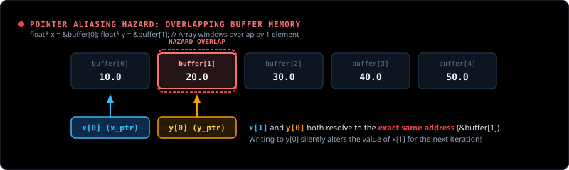
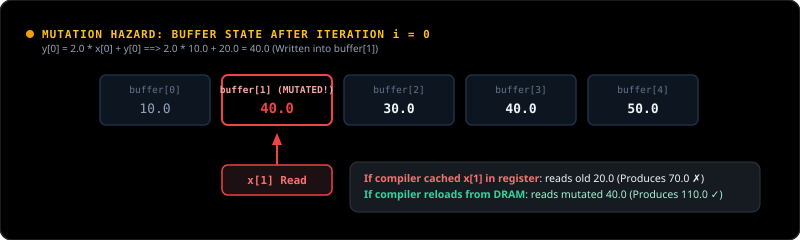
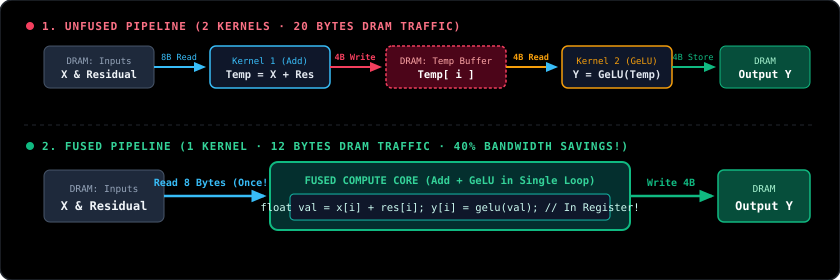

# Chapter 1.4: Compute vs Memory Bandwidth

When you run element-wise array operations—like adding two vectors `Y[i] = alpha * X[i] + Y[i]` or applying an activation function—your code often runs much slower than you expect. 

This chapter explains why: **your chip is waiting on memory bandwidth, not compute**. We will look at what causes this, the problems you run into, and how to fix them.

---

### The Big Picture

When your program is slow, there are only two possibilities:
1. **Compute-bound**: The processor is busy doing math as fast as it can.
2. **Memory-bound**: The math units are idle because the memory bus cannot feed them data fast enough.

Most vector operations in machine learning are memory-bound. To make them run fast, you have to solve four specific problems:

1. **Diagnosis**: How do you prove whether code is compute-bound or memory-bound? (Arithmetic Intensity and the Roofline Model).
2. **Compiler problem**: Why does the compiler re-read memory unnecessarily? (Pointer Aliasing and `__restrict__`).
3. **Hardware layout problem**: Why does skipping elements waste bandwidth? (Cache lines and Strides).
4. **Instruction problem**: How do you load multiple floats in one instruction? (128-bit reads and `float4`).
5. **Pipeline problem**: Why should you never write temporary arrays to RAM? (Operator Fusion).

---

## 1. The Core Problem: Compute vs Memory Bandwidth

Let us look at a standard loop that streams two arrays, known in linear algebra as **SAXPY** (`Single-precision A * X Plus Y`):

```formula
Y[i] = alpha * X[i] + Y[i]
```

In C++, you write it like this:

```cpp
void saxpy(size_t n, float alpha, const float* x, float* y) {
    for (size_t i = 0; i < n; ++i) {
        y[i] = alpha * x[i] + y[i];
    }
}
```

```diagram:saxpy
{
  "title": "Dual-Stream Vector Traversal: SAXPY",
  "subtitle": "Concurrent streaming from read-only x[ ] and read-write y[ ] over the memory bus. 2 FLOPs per 12 bytes."
}
```

Now count what happens in physical hardware for **every single element `i`**:
1. Read `x[i]` from memory into a register (4 bytes).
2. Read `y[i]` from memory into a register (4 bytes).
3. Compute `alpha * x[i] + y[i]`: 1 multiply + 1 add = **2 math operations (FLOPs)**.
4. Write `y[i]` back to memory (4 bytes).

| Step | What the Hardware Does | Data Moved |
| :--- | :--- | :--- |
| Read input `x[i]` | Memory -> Chip Register | 4 Bytes |
| Read input `y[i]` | Memory -> Chip Register | 4 Bytes |
| Write output `y[i]` | Chip Register -> Memory | 4 Bytes |
| **Total Memory Traffic** | **3 memory transfers** | **12 Bytes** |

For just **2 math operations**, the hardware has to move **12 bytes** across the memory bus. That is 6 bytes of memory traffic for every single math operation.

---

## 2. Proving the Bottleneck: Arithmetic Intensity & The Roofline Model

To know if your code is limited by math or by memory, you calculate **Arithmetic Intensity**:

```formula
Arithmetic_Intensity = Math_Operations / Bytes_Transferred
```

For SAXPY:
```formula
Arithmetic_Intensity(SAXPY) = 2 FLOPs / 12 Bytes = 0.167 FLOPs / Byte
```

Now compare this with what your hardware can actually do. This ratio is called the **Machine Balance**:

```formula
Machine_Balance = Peak_Compute_Speed / Peak_Memory_Bandwidth
```

Let us look at two real machines:

### Example 1: NVIDIA RTX 5090
* **Compute Speed**: ~108,000 GFLOPS
* **Memory Bandwidth**: ~1,800 GB/s

```formula
Machine_Balance(RTX 5090) = 108,000 / 1,800 = 60 FLOPs / Byte
```

The RTX 5090 needs **60 math operations for every 1 byte** from memory to keep all its cores busy. 
* Hardware demands: **60 FLOPs/Byte**
* SAXPY provides: **0.167 FLOPs/Byte**

```formula
Core_Utilization = 0.167 / 60 = 0.0028 (0.28%)
```
Over **99.7% of the GPU cores sit idle**. They are simply waiting for data to arrive from memory.

### Example 2: AMD Ryzen 9 9950X CPU (16 Cores)
* **Compute Speed**: ~3,500 GFLOPS
* **Memory Bandwidth**: ~96 GB/s

```formula
Machine_Balance(Ryzen 9950X) = 3,500 / 96 = 36.5 FLOPs / Byte
```
Even on a CPU, SAXPY's `0.167` is far below the required `36.5`.

```diagram:roofline
{
  "title": "Hardware Roofline Model: Memory Bound vs Compute Bound",
  "subtitle": "Interactive plot mapping arithmetic intensity against physical hardware ceilings on RTX 5090 and Ryzen 9 9950X."
}
```

### How to Read This Diagram: The 3 Modes Explained

The chart looks like a house roof with two distinct parts:
1. **The Sloping Line (Left Side)**: The **Memory Bandwidth Limit**. If your dot is on this slope, your speed is completely limited by how fast the bus can move bytes from RAM.
2. **The Flat Ceiling (Top Right)**: The **Compute Limit**. If your dot reaches this flat roof, your math units are working at 100% capacity.
3. **The Corner (The Ridge Point)**: The machine balance where memory speed and compute speed are perfectly balanced.

In the diagram, you can switch between **RTX 5090** and **Ryzen 9950X**, and click on **3 different modes** to see where real workloads land:

* **Mode 1: `SAXPY` (Intensity = 0.167 FLOPs/Byte)**:
  - This is our basic loop from Section 1: `Y[i] = alpha * X[i] + Y[i]`.
  - It does only **2 math operations** (1 multiply + 1 add) for every **12 bytes** moved from RAM.
  - Notice the dot: it sits at the **very bottom of the sloping line**.
  - **What it means**: The cores are completely starved. Over 99% of your compute capacity sits idle waiting for RAM.

* **Mode 2: `Fused` (Intensity = 0.80 FLOPs/Byte)**:
  - **What does "Fused" mean?** It simply means merging two separate steps into **one single loop**.
  - **What is GeLU?** In AI models (like GPT and BERT), after adding arrays, we apply a mathematical curve called an **activation function**. You may know **ReLU** (which simply sets negative numbers to zero: `max(0, x)`). **GeLU** is just a smooth version of ReLU that uses a few math operations (`tanh`, multiply, add).
  - In a **Fused** kernel, we do `Add` and immediately do `GeLU` in the same loop, keeping the intermediate number inside a fast CPU/GPU register.
  - Because we do **10 math operations** for the same **12 bytes** of RAM traffic, the dot moves **higher up the slope**.
  - **What it means**: It is still memory-bound, but by avoiding extra trips to RAM, it does ~5x more math per byte and runs significantly faster.

* **Mode 3: `Tiled` / GEMM (Intensity = 120.0 FLOPs/Byte)**:
  - This is **Matrix Multiplication** (`C = A * B`).
  - Unlike a vector loop, matrix multiplication loads data into on-chip cache and **reuses each number dozens or hundreds of times**.
  - Notice the dot: it jumps past the corner and lands on the **flat roof**.
  - **What it means**: It is **compute-bound**. The memory bus is no longer the bottleneck; the hardware cores are 100% saturated.

### The Big Takeaway from the Diagram
* If your workload is on the **sloping line** (`SAXPY` or `Fused`), optimizing arithmetic does nothing. You can only speed up your code by **moving fewer bytes or loading bytes more efficiently**.
* That is why the rest of this chapter focuses entirely on memory fixes: fixing pointer aliasing, fixing strides, loading 128-bit chunks, and fusing operations.

---

## 3. Problem 1: The Compiler Re-reads Memory (Pointer Aliasing)

Now you know memory bandwidth is the bottleneck. So you want your code to use 100% of the memory bus.

However, if you write naive C++ code, you will often only reach 30% to 50% of peak memory speed. The first reason is **Pointer Aliasing**.

### What is Pointer Aliasing?
Look at the function signature:
```cpp
void saxpy(int n, float a, const float* x, float* y);
```
The compiler does not know where `x` and `y` come from. In C++, two pointers are legally allowed to point to overlapping memory.

For example, a caller could pass:
```cpp
float buffer[5] = {10.0f, 20.0f, 30.0f, 40.0f, 50.0f};

const float* x = &buffer[0]; // points to indices 0, 1, 2...
float* y       = &buffer[1]; // points to indices 1, 2, 3...

saxpy(3, 2.0f, x, y);
```



Notice what happens here:
* `x[1]` and `y[0]` refer to the exact same memory location: `buffer[1]`.
* When the loop executes `i = 0`, it writes a new value to `y[0]`. That instantly overwrites `x[1]`!



### Why this hurts performance:
Because the compiler must guarantee correct results in all cases, it has to assume `x` and `y` might overlap. 

This forces the compiler to be cautious:
1. It cannot keep `x` in fast registers across loop iterations.
2. After every write to `y[i]`, it must assume `x` might have changed, so it reloads `x` from memory again.
3. It cannot unroll the loop or use wide SIMD instructions.

### The Solution: `__restrict__`
If you know `x` and `y` will never overlap, you tell the compiler by adding `__restrict__`:

```cpp
void saxpy(size_t n, float alpha, 
           const float* __restrict__ x, 
           float* __restrict__ y) {
    for (size_t i = 0; i < n; ++i) {
        y[i] = alpha * x[i] + y[i];
    }
}
```

This is a promise to the compiler: *"The memory behind `x` and `y` will never overlap."*

Now the compiler can:
* Keep values in registers instead of reloading them from RAM.
* Unroll the loop.
* Automatically use vector instructions (AVX on CPU, `LDG.E` on GPU).

---

## 4. Problem 2: Wasting Bandwidth with Strided Access

Now the compiler is optimized. But what if your algorithm does not read elements side-by-side, but skips elements?

For example:
* Reading only the red channel from interleaved RGB pixels (`stride = 3`).
* Reading a column from a matrix stored in row-major order (`stride = row_width`).

### How Hardware Reads Memory: Cache Lines
Hardware memory controllers **never fetch 4 bytes at a time**. 
They always fetch memory in fixed **64-byte chunks**, called a **cache line**. 

One 64-byte cache line holds sixteen 4-byte floats:
```formula
Floats_Per_Cache_Line = 64 Bytes / 4 Bytes = 16 Floats
```

```diagram:cache-line
{
  "title": "Hardware 64-Byte Cache Line Utilization across Strides",
  "subtitle": "Contiguous (stride=1) vs Strided (stride=4) memory bus efficiency"
}
```

Now look at what happens with different strides:

### Case 1: Contiguous (`stride = 1`)
* Your code requests `x[0]`.
* Hardware fetches the full 64-byte line containing `x[0]` through `x[15]`.
* Your code uses all 16 floats.
* **Bus Efficiency**: 16 floats used / 16 floats hauled = **100%**.

### Case 2: Stride = 2
* Your code requests `x[0]`, then `x[2]`, `x[4]`...
* Hardware still fetches 64 bytes (16 floats).
* Your code only uses the 8 even floats and ignores the 8 odd floats.
* **Bus Efficiency**: 8 floats used / 16 floats hauled = **50%**.

### Case 3: Stride = 16
* Your code requests `x[0]`, then `x[16]`, then `x[32]`...
* For every single float you read, hardware fetches a brand new 64-byte line.
* You use 1 float (4 bytes) and throw away 15 floats (60 bytes).
* **Bus Efficiency**: 4 bytes used / 64 bytes hauled = **6.25%**.

| Stride | Elements Requested | Bytes Used | Bytes Fetched by Hardware | Bus Efficiency | Speed Penalty |
| :---: | :---: | :---: | :---: | :---: | :---: |
| **`stride = 1`** | **`X[0], X[1], X[2], ... X[15]`** | 64 Bytes | 64 Bytes | **100.0%** | **1.0x (Full Speed)** |
| **`stride = 2`** | **`X[0], X[2], X[4], ... X[14]`** | 32 Bytes | 64 Bytes | **50.0%** | **2.0x Slower** |
| **`stride = 4`** | **`X[0], X[4], X[8], X[12]`** | 16 Bytes | 64 Bytes | **25.0%** | **4.0x Slower** |
| **`stride = 8`** | **`X[0], X[8]`** | 8 Bytes | 64 Bytes | **12.5%** | **8.0x Slower** |
| **`stride = 16`** | **`X[0]`** | 4 Bytes | 64 Bytes | **6.25%** | **16.0x Slower** |

> [!CAUTION]
> If your stride is 16, your program runs **16 times slower** on memory bandwidth alone, even though the total math work is identical.
> **Rule**: Always keep array traversals contiguous (`stride = 1`).

---

## 5. Problem 3: Issuing Too Many Separate Load Instructions

Now your data is contiguous (`stride = 1`) and you used `__restrict__`.

If you write a standard loop:
```cpp
for (size_t i = 0; i < n; ++i) {
    y[i] = alpha * x[i] + y[i];
}
```
The processor executes one load instruction for each 4-byte float. To load 16 floats, the processor has to decode and track 16 separate load instructions.

This wastes instruction throughput.

### The Solution: 128-Bit Loads (`float4`)
Modern CPUs and GPUs can load **16 bytes (128 bits = 4 floats)** in a **single instruction**.

* On NVIDIA GPUs: `LDG.E.128` instruction loads a `float4` (4 floats at once).
* On modern CPUs: AVX / AVX-512 vector instructions load 4 to 16 floats at once.

Here is how you write this in C++ / CUDA using `float4`:

```cpp
void saxpy_vectorized(int n, float alpha, 
                      const float* __restrict__ x, 
                      float* __restrict__ y) {
    int n_vec = n / 4;
    
    // Cast pointers to float4 (16 bytes each)
    const float4* vx = reinterpret_cast<const float4*>(x);
    float4* vy = reinterpret_cast<float4*>(y);
    
    // Main loop: 4 floats per iteration in 1 instruction
    for (int i = 0; i < n_vec; ++i) {
        float4 x4 = vx[i]; // Loads 16 bytes in 1 memory instruction
        float4 y4 = vy[i]; // Loads 16 bytes in 1 memory instruction
        
        y4.x = alpha * x4.x + y4.x;
        y4.y = alpha * x4.y + y4.y;
        y4.z = alpha * x4.z + y4.z;
        y4.w = alpha * x4.w + y4.w;
        
        vy[i] = y4;        // Stores 16 bytes in 1 memory instruction
    }
    
    // Cleanup loop for any leftover elements (if n is not divisible by 4)
    for (int i = n_vec * 4; i < n; ++i) {
        y[i] = alpha * x[i] + y[i];
    }
}
```

### The Alignment Requirement
For 128-bit loads to work without errors:
* The starting memory address must be **16-byte aligned** (`address % 16 == 0`).
* On GPUs, attempting a 128-bit load from an unaligned address causes a hardware crash: `CUDA_ERROR_ILLEGAL_ADDRESS`.
* Standard GPU allocators (`cudaMalloc`) always return memory aligned to at least 256 bytes, so this is naturally safe when starting at index 0.

---

## 6. Problem 4: Writing Temporary Arrays to RAM (Operator Fusion)

Now your single loop is as fast as the hardware allows.

However, in real machine learning models (like Transformer blocks in GPT or LLaMA), you rarely run just one lone loop. You run several operations back-to-back:
1. First, you add two arrays together: `Temp = X + Residual`.
2. Second, you apply an **activation function** to that result: `Y = GeLU(Temp)`.

### What is an Activation Function (and what is GeLU)?
In neural networks, after adding numbers, you apply a mathematical curve to each number so the network can learn complex patterns instead of just straight lines.
* **ReLU**: The simplest activation function. It simply clamps negative numbers to zero: `if x < 0 return 0; else return x;`.
* **GeLU (Gaussian Error Linear Unit)**: The activation function used in modern language models like GPT. It is just a smooth, curved version of ReLU. The formula looks fancy (`0.5 * x * (1 + tanh(...))`), but mathematically it is just **8 basic arithmetic operations** applied to a single float.

Now look at what happens when you run these two steps in code:

### The Naive Way (Unfused: Two Separate Loops)
In naive code, you write two separate loops (or launch two separate GPU kernels):
* **Loop 1 (`Add`)**: Reads `X` and `Residual` from RAM, adds them, and writes the intermediate result `Temp` to RAM.
* **Loop 2 (`GeLU`)**: Reads `Temp` back from RAM, applies the GeLU math curve, and writes `Y` to RAM.



Look at what happens to memory:
* Kernel 1 reads `X` and `Residual` from RAM, computes `Temp`, and **writes `Temp` to RAM** (4 bytes).
* Kernel 2 immediately **reads `Temp` back from RAM** (4 bytes), computes `GeLU`, and writes `Y` to RAM.

```formula
Unfused_Traffic = 4B(X) + 4B(Residual) + 4B(Temp Write) + 4B(Temp Read) + 4B(Y) = 20 Bytes
```

Notice the waste: `Temp` was written to RAM only to be read back a microsecond later and deleted.

### The Solution: Operator Fusion
In a fused kernel, both operations happen in the same loop. The intermediate value `val` stays inside **chip registers** and is never written to RAM:

```cpp
void fused_add_gelu(int n, 
                    const float* __restrict__ x, 
                    const float* __restrict__ residual, 
                    float* __restrict__ y) {
    for (int i = 0; i < n; ++i) {
        // Step 1: Read inputs once
        float val = x[i] + residual[i]; // 'val' lives in a fast register!
        
        // Step 2: Compute GeLU directly from the register
        float cube = val * val * val;
        float inner = 0.79788456f * (val + 0.044715f * cube);
        float gelu = 0.5f * val * (1.0f + tanhf(inner));
        
        // Step 3: Write only the final result to RAM
        y[i] = gelu;
    }
}
```

```formula
Fused_Traffic = 4B(X) + 4B(Residual) + 4B(Y) = 12 Bytes
```

### The Difference:

| Metric | Without Fusion | With Fusion | Improvement |
| :--- | :--- | :--- | :--- |
| **DRAM Memory Traffic** | 20 Bytes / element | **12 Bytes / element** | **40% less memory traffic** |
| **Kernel Launches** | 2 launches | **1 launch** | **50% less launch overhead** |
| **Intermediate RAM** | Needs a buffer for `Temp` | **Zero buffer needed** | **Saves Gigabytes of VRAM** |
| **Speed** | Slow (waits on RAM) | **1.6x to 2.0x faster** | Direct speedup |

This is why **PyTorch 2.0 (TorchInductor)** and **FlashAttention** exist: they fuse memory-bound operations so intermediate tensors never travel back and forth to RAM.

---

## 7. Summary: What Problem, What Cause, What Fix

| Step | Problem You Face | What Causes It | How to Fix It |
| :--- | :--- | :--- | :--- |
| **1. Bottleneck** | Code runs way below chip specs | Low arithmetic intensity (math is fast, memory bus is narrow) | Check Roofline model. Focus on optimizing memory traffic. |
| **2. Compiler** | Compiler re-reads memory over and over | It fears pointers might overlap (aliasing) | Use **`__restrict__`** so compiler keeps data in registers. |
| **3. Memory Layout** | 50% to 93% of memory traffic is discarded | Non-unit strides skip data inside 64-byte cache lines | Keep data contiguous (**`stride = 1`**). |
| **4. Instructions** | Too many separate 32-bit load commands | Reading 4 bytes per instruction wastes issue slots | Use **128-bit loads (`float4`)** to read 16 bytes at once. |
| **5. Pipelines** | Writing temporary tensors back and forth to RAM | Running separate kernels for back-to-back operations | Use **Operator Fusion** to keep intermediate data in registers. |
